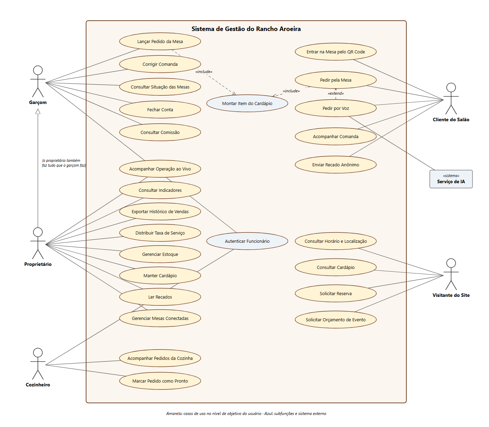

# Casos de Uso — Sistema de Gestão do Rancho Aroeira

**EEL873 — Engenharia de Software (UFRJ, 2026/2) · Grupo F**

## 1. Diagrama de casos de uso

*(Versão vetorial: [diagrama-casos-de-uso.svg](diagrama-casos-de-uso.svg))*

### Atores

| Ator | Tipo | Papel |
|---|---|---|
| Garçom | Pessoa | Lança pedidos, acompanha as mesas e fecha contas |
| Proprietário | Pessoa | Gestão da casa. **Especializa o Garçom**: faz tudo o que o garçom faz, mais a gestão |
| Cozinheiro | Pessoa | Prepara os pedidos que chegam ao monitor da cozinha |
| Cliente do Salão | Pessoa | Pede e acompanha a comanda pelo celular, lendo o QR code da mesa |
| Visitante do Site | Pessoa | Consulta informações da casa e faz reservas e pedidos de orçamento |
| Serviço de IA | Sistema externo | Transcreve e interpreta a fala do cliente no pedido por voz |

### Casos de uso (26)

| Ator | Casos de uso |
|---|---|
| Garçom | Lançar Pedido da Mesa · Corrigir Comanda · Consultar Situação das Mesas · Fechar Conta · Consultar Comissão |
| Proprietário | Acompanhar Operação ao Vivo · Consultar Indicadores · Exportar Histórico de Vendas · Distribuir Taxa de Serviço · Gerenciar Estoque · Manter Cardápio · Ler Recados · Gerenciar Mesas Conectadas (e, por herança, todos os do Garçom) |
| Cozinheiro | Acompanhar Pedidos da Cozinha · Marcar Pedido como Pronto |
| Cliente do Salão | Entrar na Mesa pelo QR Code · Pedir pela Mesa · Pedir por Voz · Acompanhar Comanda · Enviar Recado Anônimo |
| Visitante do Site | Consultar Horário e Localização · Consultar Cardápio · Solicitar Reserva · Solicitar Orçamento de Evento |
| Subfunções | **Montar Item do Cardápio** (tamanho, ponto da carne e acompanhamentos), incluída por *Lançar Pedido da Mesa* e *Pedir pela Mesa* · **Autenticar Funcionário**, usada por garçom, proprietário e cozinheiro |

**Relações:** *Pedir por Voz* **estende** *Pedir pela Mesa* (é inserido quando o cliente escolhe falar ou escrever em vez de tocar no cardápio). *Lançar Pedido da Mesa* e *Pedir pela Mesa* **incluem** *Montar Item do Cardápio*, para que garçom e cliente montem o item com as mesmas regras.

**Escopo e nível:** todos os casos de uso estão no escopo **sistema, caixa-preta** e no nível **objetivo do usuário** (uma pessoa, uma sessão), exceto as duas subfunções.

---

## 2. Casos de uso descritos (um por integrante)

Foram escolhidos os quatro maiores: os dois caminhos de pedido (garçom e cliente), o pedido por voz e o fechamento da conta.

| Integrante | Caso de uso |
|---|---|
| João Paulo Garcia | UC01 — Pedir pela Mesa |
| Gabriel dos Santos Percu Saldanha | UC02 — Lançar Pedido da Mesa |
| Henrique Gebara | UC03 — Fechar Conta |
| Danilo Santiago Baptista | UC04 — Pedir por Voz |

---

### UC01 — Pedir pela Mesa
**Responsável:** João Paulo Garcia

| Campo | Descrição |
|---|---|
| **Escopo** | Sistema de Gestão do Rancho Aroeira, caixa-preta |
| **Nível** | Objetivo do usuário |
| **Ator principal** | Cliente do Salão |
| **Atores secundários** | — |
| **Interessados e interesses** | **Cliente:** pedir rápido, sem esperar o garçom, e ver o que pediu. **Proprietário:** que todo pedido entre na comanda da mesa certa e com o preço do cardápio. **Cozinheiro:** receber o pedido completo (ponto e acompanhamentos). **Garçom:** não ser surpreendido por pedido de mesa que ele não atende |
| **Pré-condições** | O cliente entrou na mesa pelo QR code (*Entrar na Mesa pelo QR Code*) e a sessão da mesa está aberta |
| **Gatilho** | O cliente toca em "adicionar" num produto do cardápio |
| **Pós-condições de sucesso** | O pedido está registrado na comanda da mesa, com preços calculados pelo sistema, e aparece no monitor da cozinha (e no bar, se houver bebidas) |
| **Garantias em caso de falha** | Nenhum pedido parcial é gravado; o carrinho do cliente é mantido para nova tentativa |

**Cenário principal**
1. O sistema apresenta o cardápio por categorias, com busca por nome.
2. O cliente escolhe um produto.
3. O sistema executa *Montar Item do Cardápio* (tamanho, ponto da carne e acompanhamentos, quando o produto exige).
4. O sistema adiciona o item ao carrinho e mostra o subtotal.
5. O cliente repete os passos 2 a 4 até terminar de escolher.
6. O cliente abre o carrinho e confirma o envio.
7. O sistema valida a sessão da mesa e cada item contra o cardápio vigente.
8. O sistema calcula os preços a partir do cardápio, registra o pedido na comanda da mesa e o envia à cozinha e ao bar.
9. O sistema informa ao cliente que o pedido foi enviado e mostra a comanda atualizada.

**Fluxos alternativos**
- **5a. O cliente remove ou altera a quantidade de um item do carrinho:** 5a.1. O sistema atualiza o carrinho e o subtotal. 5a.2. Volta ao passo 5.
- **6a. O carrinho está vazio:** 6a.1. O sistema não permite o envio. 6a.2. Volta ao passo 1.
- **7a. A sessão da mesa expirou ou foi encerrada pelo caixa:** 7a.1. O sistema informa que é preciso ler o QR code da mesa de novo. 7a.2. O caso de uso termina sem enviar (o carrinho é mantido no aparelho).
- **7b. Um item deixou de existir ou mudou de regra no cardápio:** 7b.1. O sistema informa qual item precisa ser revisto. 7b.2. Volta ao passo 4.
- **7c. A mesa enviou um pedido há poucos segundos:** 7c.1. O sistema pede para aguardar alguns segundos (evita envio duplicado por toque duplo). 7c.2. Volta ao passo 6.
- **8a. Falha de comunicação com o servidor:** 8a.1. O sistema informa que o pedido não foi enviado e mantém o carrinho. 8a.2. Volta ao passo 6.

**Requisitos especiais**
- O cliente **nunca envia preço**: só envia produto, opção, ponto, acompanhamentos e quantidade; o preço é sempre calculado no servidor.
- Carnes principais exigem ponto; acompanhamentos limitados à lista de cada categoria; quantidade de 1 a 20 por item.
- Funciona no navegador do celular, sem instalar aplicativo; campos com fonte de pelo menos 16px (evita zoom automático no iPhone).

**Variações tecnológicas e de dados:** o passo 2 pode ser feito por toque (este caso de uso) ou por voz (*Pedir por Voz*, que estende este).
**Frequência:** dezenas de vezes por dia de funcionamento, concentradas no pico do almoço.
**Questões em aberto:** o garçom deve ser avisado quando a sua mesa faz um pedido pelo celular?

---

### UC02 — Lançar Pedido da Mesa
**Responsável:** Gabriel dos Santos Percu Saldanha

| Campo | Descrição |
|---|---|
| **Escopo** | Sistema de Gestão do Rancho Aroeira, caixa-preta |
| **Nível** | Objetivo do usuário |
| **Ator principal** | Garçom (ou Proprietário, por herança) |
| **Atores secundários** | — |
| **Interessados e interesses** | **Garçom:** lançar rápido, sem voltar à cozinha. **Cozinheiro:** pedido legível, com ponto e acompanhamentos. **Cliente:** receber exatamente o que pediu. **Proprietário:** nada consumido fora da comanda |
| **Pré-condições** | O garçom está autenticado (*Autenticar Funcionário*) |
| **Gatilho** | O cliente faz o pedido ao garçom na mesa |
| **Pós-condições de sucesso** | O pedido está na comanda da mesa e no monitor da cozinha e do bar; a mesa aparece como ocupada |
| **Garantias em caso de falha** | O carrinho do garçom é mantido no aparelho até ser enviado |

**Cenário principal**
1. O garçom escolhe a mesa na tela das 15 mesas.
2. O sistema mostra o cardápio da mesa, a comanda já existente e o subtotal.
3. O garçom busca o produto por nome ou categoria.
4. O sistema executa *Montar Item do Cardápio*.
5. O sistema adiciona o item ao carrinho da mesa.
6. O garçom repete os passos 3 a 5 até terminar.
7. O garçom confirma o envio.
8. O sistema registra o pedido na comanda da mesa com status "pendente" e o envia à cozinha e ao bar, separando os itens por setor.
9. O sistema limpa o carrinho, atualiza a comanda e marca a mesa como ocupada.

**Fluxos alternativos**
- **3a. O produto não está no cardápio (pedido especial):** 3a.1. O garçom escolhe "item avulso" e informa nome, preço e setor (cozinha ou bar). 3a.2. O sistema adiciona o item, marcado como avulso. 3a.3. Volta ao passo 6.
- **5a. Item igual (mesmo produto, ponto e acompanhamentos) já está no carrinho:** 5a.1. O sistema soma a quantidade na mesma linha. 5a.2. Volta ao passo 6.
- **6a. O garçom troca de mesa antes de enviar:** 6a.1. O sistema guarda o carrinho da mesa anterior. 6a.2. Volta ao passo 1.
- **7a. O carrinho está vazio:** 7a.1. O sistema não permite o envio. 7a.2. Volta ao passo 3.
- **8a. Falha de comunicação:** 8a.1. O sistema avisa e mantém o carrinho. 8a.2. Volta ao passo 7.
- **8b. A sessão do garçom expirou:** 8b.1. O sistema pede novo login (*Autenticar Funcionário*), mantendo o carrinho. 8b.2. Volta ao passo 7.

**Requisitos especiais**
- O pedido deve aparecer no monitor da cozinha em poucos segundos, sem recarregar a página.
- Usável com uma mão, em pé, no salão; botões grandes; carrinho preservado se o celular bloquear a tela.

**Variações tecnológicas e de dados:** número de mesas configurável (hoje 15).
**Frequência:** é o caso de uso mais executado do sistema — várias vezes por mesa a cada almoço.
**Questões em aberto:** limite de valor para item avulso sem aprovação do proprietário?

---

### UC03 — Fechar Conta
**Responsável:** Henrique Gebara

| Campo | Descrição |
|---|---|
| **Escopo** | Sistema de Gestão do Rancho Aroeira, caixa-preta |
| **Nível** | Objetivo do usuário |
| **Ator principal** | Garçom (ou Proprietário, no caixa) |
| **Atores secundários** | — |
| **Interessados e interesses** | **Cliente:** pagar o valor certo, com a taxa de serviço opcional. **Proprietário:** toda venda registrada, com forma de pagamento, para o caixa e os relatórios. **Garçons:** a taxa de serviço paga registrada corretamente para a divisão da comissão. **Fisco:** venda registrada com valor coerente |
| **Pré-condições** | Funcionário autenticado; a mesa tem comanda com pelo menos um item |
| **Gatilho** | O cliente pede a conta |
| **Pós-condições de sucesso** | A venda está no histórico com itens, subtotal, indicação de taxa paga, forma de pagamento e tempo médio de preparo; os pedidos da mesa estão finalizados; a sessão de QR da mesa está encerrada; o estoque dos itens vendidos foi baixado; a mesa está livre |
| **Garantias em caso de falha** | A comanda permanece aberta, sem venda duplicada no histórico |

**Cenário principal**
1. O funcionário escolhe a mesa e a opção "fechar conta".
2. O sistema mostra todos os itens da comanda, o subtotal, a taxa de serviço de 10% e o total.
3. O funcionário pergunta ao cliente e confirma se a taxa de serviço será paga.
4. O sistema recalcula o total.
5. O funcionário informa a forma de pagamento (Pix, cartão de crédito, cartão de débito ou dinheiro).
6. O funcionário confirma o fechamento.
7. O sistema registra a venda no histórico, com o valor sem a taxa e a indicação de que a taxa foi paga.
8. O sistema marca os pedidos da mesa como finalizados e encerra a sessão de QR code da mesa.
9. O sistema baixa do estoque os insumos dos itens vendidos.
10. O sistema mostra o cupom para impressão e a mesa volta a ficar livre.

**Fluxos alternativos**
- **2a. Ainda há itens pendentes na cozinha:** 2a.1. O sistema avisa quais itens não foram entregues. 2a.2. O funcionário escolhe continuar (2a.3. volta ao passo 3) ou cancelar o fechamento (2a.4. o caso de uso termina).
- **3a. O cliente não paga a taxa de serviço:** 3a.1. O funcionário desmarca a taxa. 3a.2. Volta ao passo 4.
- **5a. Pagamento em dinheiro com troco:** 5a.1. O funcionário informa o valor recebido. 5a.2. O sistema mostra o troco. 5a.3. Volta ao passo 6.
- **5b. A mesa divide a conta em mais de uma forma de pagamento:** 5b.1. O funcionário registra a forma principal e anota a divisão no campo de observação. 5b.2. Volta ao passo 6.
- **6a. O cliente contesta um item:** 6a.1. O funcionário executa *Corrigir Comanda*. 6a.2. Volta ao passo 2.
- **7a. Falha ao gravar a venda:** 7a.1. O sistema avisa e não altera a comanda. 7a.2. Volta ao passo 6.
- **9a. Insumo sem cadastro no estoque:** 9a.1. O sistema registra a venda normalmente e marca o item para revisão no estoque. 9a.2. Segue no passo 10.

**Requisitos especiais**
- A venda é gravada com o **valor sem a taxa** e a indicação de taxa paga; relatórios e indicadores somam a taxa quando paga. Esse padrão deve ser o **mesmo** no fechamento pelo garçom e pelo caixa, para não contar a taxa duas vezes.
- O fechamento não pode ser feito duas vezes para a mesma comanda.

**Variações tecnológicas e de dados:** cupom em formato de impressora térmica.
**Frequência:** uma vez por mesa atendida.
**Questões em aberto:** integrar a emissão de nota fiscal eletrônica em versão futura?

---

### UC04 — Pedir por Voz
**Responsável:** Danilo Santiago Baptista

| Campo | Descrição |
|---|---|
| **Escopo** | Sistema de Gestão do Rancho Aroeira, caixa-preta |
| **Nível** | Objetivo do usuário (estende *Pedir pela Mesa*) |
| **Ator principal** | Cliente do Salão |
| **Atores secundários** | Serviço de IA (transcrição e interpretação da fala) |
| **Interessados e interesses** | **Cliente:** pedir falando, como falaria ao garçom. **Proprietário:** que a IA não invente item nem preço e que o custo de uso seja controlado. **Cozinheiro:** receber o pedido com ponto e acompanhamentos. **ANPD:** áudio do cliente usado só para o pedido |
| **Ponto de extensão** | Passo 2 de *Pedir pela Mesa* (escolha do produto) |
| **Pré-condições** | Sessão da mesa aberta; o celular permite o uso do microfone (ou o cliente escolhe escrever) |
| **Gatilho** | O cliente toca no botão de falar |
| **Pós-condições de sucesso** | Os itens entendidos estão no carrinho da mesa, com tamanho, ponto e acompanhamentos, aguardando a confirmação do cliente (o envio segue em *Pedir pela Mesa*) |
| **Garantias em caso de falha** | Nenhum item é adicionado sem o cliente ver e confirmar; nada é enviado à cozinha por este caso de uso |

**Cenário principal**
1. O cliente segura o botão e fala o pedido (ex.: "uma picanha para dois, ao ponto, com farofa e duas cocas").
2. O cliente solta o botão.
3. O sistema envia o áudio ao Serviço de IA.
4. O Serviço de IA transcreve a fala.
5. O sistema envia o texto e o cardápio vigente ao Serviço de IA.
6. O Serviço de IA devolve os itens interpretados.
7. O sistema valida cada item contra o cardápio (produto existente, tamanho, ponto, acompanhamentos permitidos) e monta os itens com os preços do cardápio.
8. O sistema responde em texto o que entendeu e mostra os itens para confirmação.
9. O cliente confirma.
10. O sistema adiciona os itens ao carrinho; o caso de uso retorna a *Pedir pela Mesa* no passo 4.

**Fluxos alternativos**
- **1a. O cliente prefere escrever:** 1a.1. O cliente digita o pedido. 1a.2. Segue no passo 5.
- **2a. O cliente arrasta para cima para travar a gravação:** 2a.1. O sistema continua gravando sem precisar segurar. 2a.2. O cliente toca em enviar ou descartar. 2a.3. Se enviar, segue no passo 3; se descartar, o caso de uso termina.
- **3a. O áudio está em silêncio ou curto demais:** 3a.1. O sistema avisa que não ouviu nada. 3a.2. Volta ao passo 1.
- **3b. A mesa atingiu o limite de falas da sessão:** 3b.1. O sistema sugere usar o cardápio ou chamar o garçom. 3b.2. O caso de uso termina.
- **6a. O pedido é ambíguo (ex.: "uma picanha" — há a normal, a premium e a do prato executivo):** 6a.1. O sistema pergunta ao cliente qual delas, com as opções e os preços do cardápio. 6a.2. O cliente responde falando ou escrevendo. 6a.3. Volta ao passo 5, com o histórico da conversa.
- **6b. Faltam informações obrigatórias (ex.: o ponto da carne):** 6b.1. O sistema anota o que entendeu e pergunta o que falta. 6b.2. Volta ao passo 1.
- **6c. O cliente fez uma pergunta sobre o cardápio:** 6c.1. O sistema responde com base no cardápio. 6c.2. Volta ao passo 1.
- **6d. O Serviço de IA não responde:** 6d.1. O sistema tenta outro modelo de IA. 6d.2. Se nenhum responder, avisa e sugere o cardápio por toque; o caso de uso termina.
- **7a. A IA devolveu item que não existe no cardápio:** 7a.1. O sistema descarta o item e informa o cliente. 7a.2. Segue no passo 8 com os itens válidos.
- **9a. O cliente corrige algo:** 9a.1. O cliente fala a correção. 9a.2. Volta ao passo 3.

**Requisitos especiais**
- A IA **nunca define preço nem envia pedido**: preços vêm do cardápio e o envio exige a confirmação do cliente.
- Ambiguidades decididas por regra do sistema (a IA só redige a pergunta), para não esconder opções do cliente.
- Limite de falas por sessão e intervalo mínimo entre falas, para controlar custo e abuso.
- Priorizar serviço de IA com plano gratuito; o pago só como reserva.
- O áudio é usado só para transcrever o pedido; a fala transcrita fica guardada por prazo limitado para melhorar o sistema.

**Variações tecnológicas e de dados:** gravação por *MediaRecorder* no navegador (áudio em webm no Android e mp4 no iPhone); entrada por texto como alternativa.
**Frequência:** parte dos pedidos feitos pela mesa; tende a crescer entre clientes com pouca familiaridade com o cardápio digital.
**Questões em aberto:** qual o limite ideal de falas por mesa? A IA deve sugerir acompanhamentos ou só registrar o que o cliente pediu?
