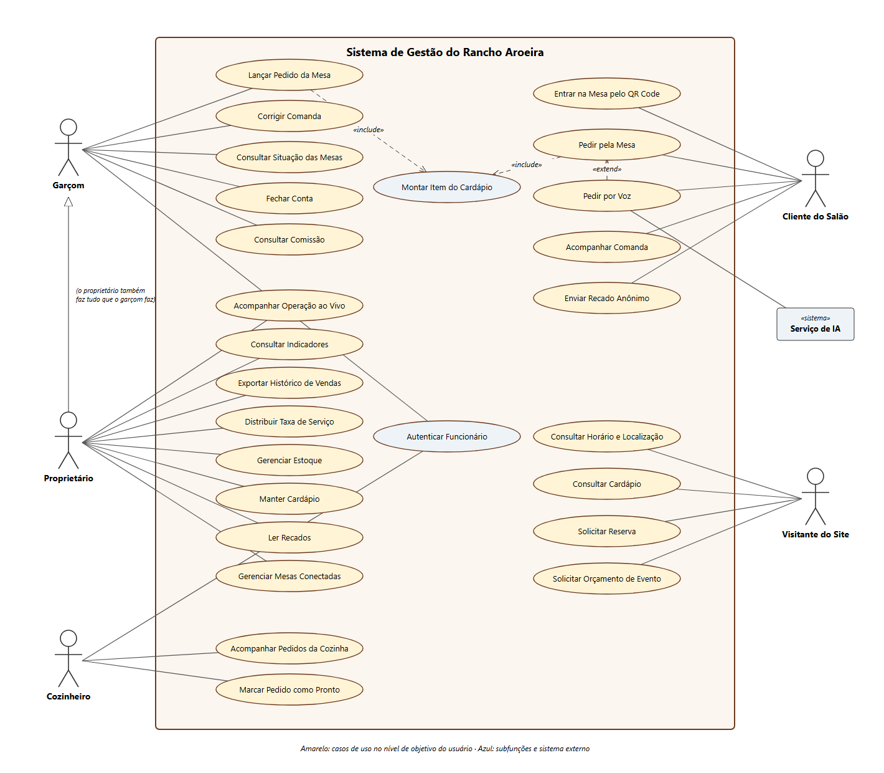

# UC01 — Pedir pela Mesa

**EEL873 — Engenharia de Software (UFRJ, 2026/2) · Grupo F · Sistema de Gestão do Rancho Aroeira**  
**Aluno:** João Paulo Garcia

## 1. Diagrama de casos de uso do sistema

O diagrama é o mesmo para todo o grupo; cada integrante descreve um caso de uso. Lista completa de atores e casos de uso: [casos-de-uso.md](../casos-de-uso.md).

## 2. Caso de uso descrito

### UC01 — Pedir pela Mesa
**Responsável:** João Paulo Garcia

| Campo | Descrição |
|---|---|
| **Escopo** | Sistema de Gestão do Rancho Aroeira, caixa-preta |
| **Nível** | Objetivo do usuário |
| **Ator principal** | Cliente do Salão |
| **Atores secundários** | — |
| **Interessados e interesses** | **Cliente:** pedir rápido, sem esperar o garçom, e ver o que pediu. **Proprietário:** que todo pedido entre na comanda da mesa certa e com o preço do cardápio. **Cozinheiro:** receber o pedido completo (ponto e acompanhamentos). **Garçom:** não ser surpreendido por pedido de mesa que ele não atende |
| **Pré-condições** | O cliente entrou na mesa pelo QR code (*Entrar na Mesa pelo QR Code*) e a sessão da mesa está aberta |
| **Gatilho** | O cliente toca em "adicionar" num produto do cardápio |
| **Pós-condições de sucesso** | O pedido está registrado na comanda da mesa, com preços calculados pelo sistema, e aparece no monitor da cozinha (e no bar, se houver bebidas) |
| **Garantias em caso de falha** | Nenhum pedido parcial é gravado; o carrinho do cliente é mantido para nova tentativa |

**Cenário principal**
1. O sistema apresenta o cardápio por categorias, com busca por nome.
2. O cliente escolhe um produto.
3. O sistema executa *Montar Item do Cardápio* (tamanho, ponto da carne e acompanhamentos, quando o produto exige).
4. O sistema adiciona o item ao carrinho e mostra o subtotal.
5. O cliente repete os passos 2 a 4 até terminar de escolher.
6. O cliente abre o carrinho e confirma o envio.
7. O sistema valida a sessão da mesa e cada item contra o cardápio vigente.
8. O sistema calcula os preços a partir do cardápio, registra o pedido na comanda da mesa e o envia à cozinha e ao bar.
9. O sistema informa ao cliente que o pedido foi enviado e mostra a comanda atualizada.

**Fluxos alternativos**
- **5a. O cliente remove ou altera a quantidade de um item do carrinho:** 5a.1. O sistema atualiza o carrinho e o subtotal. 5a.2. Volta ao passo 5.
- **6a. O carrinho está vazio:** 6a.1. O sistema não permite o envio. 6a.2. Volta ao passo 1.
- **7a. A sessão da mesa expirou ou foi encerrada pelo caixa:** 7a.1. O sistema informa que é preciso ler o QR code da mesa de novo. 7a.2. O caso de uso termina sem enviar (o carrinho é mantido no aparelho).
- **7b. Um item deixou de existir ou mudou de regra no cardápio:** 7b.1. O sistema informa qual item precisa ser revisto. 7b.2. Volta ao passo 4.
- **7c. A mesa enviou um pedido há poucos segundos:** 7c.1. O sistema pede para aguardar alguns segundos (evita envio duplicado por toque duplo). 7c.2. Volta ao passo 6.
- **8a. Falha de comunicação com o servidor:** 8a.1. O sistema informa que o pedido não foi enviado e mantém o carrinho. 8a.2. Volta ao passo 6.

**Requisitos especiais**
- O cliente **nunca envia preço**: só envia produto, opção, ponto, acompanhamentos e quantidade; o preço é sempre calculado no servidor.
- Carnes principais exigem ponto; acompanhamentos limitados à lista de cada categoria; quantidade de 1 a 20 por item.
- Funciona no navegador do celular, sem instalar aplicativo; campos com fonte de pelo menos 16px (evita zoom automático no iPhone).

**Variações tecnológicas e de dados:** o passo 2 pode ser feito por toque (este caso de uso) ou por voz (*Pedir por Voz*, que estende este).
**Frequência:** dezenas de vezes por dia de funcionamento, concentradas no pico do almoço.
**Questões em aberto:** o garçom deve ser avisado quando a sua mesa faz um pedido pelo celular?
