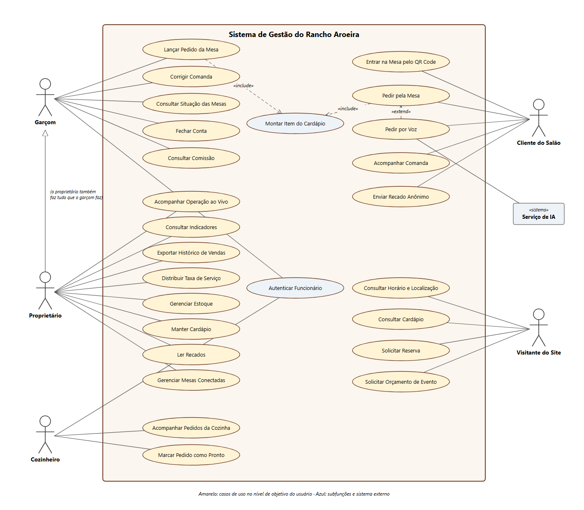

# UC02 — Lançar Pedido da Mesa

**EEL873 — Engenharia de Software (UFRJ, 2026/2) · Grupo F · Sistema de Gestão do Rancho Aroeira**  
**Aluno:** Gabriel dos Santos Percu Saldanha

## 1. Diagrama de casos de uso do sistema

O diagrama é o mesmo para todo o grupo; cada integrante descreve um caso de uso. Lista completa de atores e casos de uso: [casos-de-uso.md](../casos-de-uso.md).

## 2. Caso de uso descrito

### UC02 — Lançar Pedido da Mesa
**Responsável:** Gabriel dos Santos Percu Saldanha

| Campo | Descrição |
|---|---|
| **Escopo** | Sistema de Gestão do Rancho Aroeira, caixa-preta |
| **Nível** | Objetivo do usuário |
| **Ator principal** | Garçom (ou Proprietário, por herança) |
| **Atores secundários** | — |
| **Interessados e interesses** | **Garçom:** lançar rápido, sem voltar à cozinha. **Cozinheiro:** pedido legível, com ponto e acompanhamentos. **Cliente:** receber exatamente o que pediu. **Proprietário:** nada consumido fora da comanda |
| **Pré-condições** | O garçom está autenticado (*Autenticar Funcionário*) |
| **Gatilho** | O cliente faz o pedido ao garçom na mesa |
| **Pós-condições de sucesso** | O pedido está na comanda da mesa e no monitor da cozinha e do bar; a mesa aparece como ocupada |
| **Garantias em caso de falha** | O carrinho do garçom é mantido no aparelho até ser enviado |

**Cenário principal**
1. O garçom escolhe a mesa na tela das 15 mesas.
2. O sistema mostra o cardápio da mesa, a comanda já existente e o subtotal.
3. O garçom busca o produto por nome ou categoria.
4. O sistema executa *Montar Item do Cardápio*.
5. O sistema adiciona o item ao carrinho da mesa.
6. O garçom repete os passos 3 a 5 até terminar.
7. O garçom confirma o envio.
8. O sistema registra o pedido na comanda da mesa com status "pendente" e o envia à cozinha e ao bar, separando os itens por setor.
9. O sistema limpa o carrinho, atualiza a comanda e marca a mesa como ocupada.

**Fluxos alternativos**
- **3a. O produto não está no cardápio (pedido especial):** 3a.1. O garçom escolhe "item avulso" e informa nome, preço e setor (cozinha ou bar). 3a.2. O sistema adiciona o item, marcado como avulso. 3a.3. Volta ao passo 6.
- **5a. Item igual (mesmo produto, ponto e acompanhamentos) já está no carrinho:** 5a.1. O sistema soma a quantidade na mesma linha. 5a.2. Volta ao passo 6.
- **6a. O garçom troca de mesa antes de enviar:** 6a.1. O sistema guarda o carrinho da mesa anterior. 6a.2. Volta ao passo 1.
- **7a. O carrinho está vazio:** 7a.1. O sistema não permite o envio. 7a.2. Volta ao passo 3.
- **8a. Falha de comunicação:** 8a.1. O sistema avisa e mantém o carrinho. 8a.2. Volta ao passo 7.
- **8b. A sessão do garçom expirou:** 8b.1. O sistema pede novo login (*Autenticar Funcionário*), mantendo o carrinho. 8b.2. Volta ao passo 7.

**Requisitos especiais**
- O pedido deve aparecer no monitor da cozinha em poucos segundos, sem recarregar a página.
- Usável com uma mão, em pé, no salão; botões grandes; carrinho preservado se o celular bloquear a tela.

**Variações tecnológicas e de dados:** número de mesas configurável (hoje 15).
**Frequência:** é o caso de uso mais executado do sistema — várias vezes por mesa a cada almoço.
**Questões em aberto:** limite de valor para item avulso sem aprovação do proprietário?
