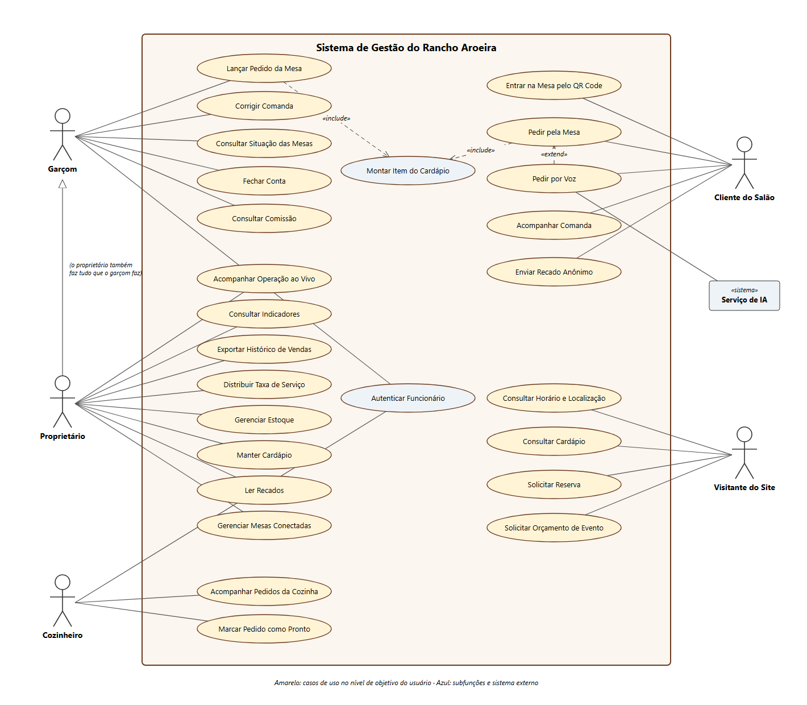

# UC03 — Fechar Conta

**EEL873 — Engenharia de Software (UFRJ, 2026/2) · Grupo F · Sistema de Gestão do Rancho Aroeira**  
**Aluno:** Henrique Gebara

## 1. Diagrama de casos de uso do sistema

O diagrama é o mesmo para todo o grupo; cada integrante descreve um caso de uso. Lista completa de atores e casos de uso: [casos-de-uso.md](../casos-de-uso.md).

## 2. Caso de uso descrito

### UC03 — Fechar Conta
**Responsável:** Henrique Gebara

| Campo | Descrição |
|---|---|
| **Escopo** | Sistema de Gestão do Rancho Aroeira, caixa-preta |
| **Nível** | Objetivo do usuário |
| **Ator principal** | Garçom (ou Proprietário, no caixa) |
| **Atores secundários** | — |
| **Interessados e interesses** | **Cliente:** pagar o valor certo, com a taxa de serviço opcional. **Proprietário:** toda venda registrada, com forma de pagamento, para o caixa e os relatórios. **Garçons:** a taxa de serviço paga registrada corretamente para a divisão da comissão. **Fisco:** venda registrada com valor coerente |
| **Pré-condições** | Funcionário autenticado; a mesa tem comanda com pelo menos um item |
| **Gatilho** | O cliente pede a conta |
| **Pós-condições de sucesso** | A venda está no histórico com itens, subtotal, indicação de taxa paga, forma de pagamento e tempo médio de preparo; os pedidos da mesa estão finalizados; a sessão de QR da mesa está encerrada; o estoque dos itens vendidos foi baixado; a mesa está livre |
| **Garantias em caso de falha** | A comanda permanece aberta, sem venda duplicada no histórico |

**Cenário principal**
1. O funcionário escolhe a mesa e a opção "fechar conta".
2. O sistema mostra todos os itens da comanda, o subtotal, a taxa de serviço de 10% e o total.
3. O funcionário pergunta ao cliente e confirma se a taxa de serviço será paga.
4. O sistema recalcula o total.
5. O funcionário informa a forma de pagamento (Pix, cartão de crédito, cartão de débito ou dinheiro).
6. O funcionário confirma o fechamento.
7. O sistema registra a venda no histórico, com o valor sem a taxa e a indicação de que a taxa foi paga.
8. O sistema marca os pedidos da mesa como finalizados e encerra a sessão de QR code da mesa.
9. O sistema baixa do estoque os insumos dos itens vendidos.
10. O sistema mostra o cupom para impressão e a mesa volta a ficar livre.

**Fluxos alternativos**
- **2a. Ainda há itens pendentes na cozinha:** 2a.1. O sistema avisa quais itens não foram entregues. 2a.2. O funcionário escolhe continuar (2a.3. volta ao passo 3) ou cancelar o fechamento (2a.4. o caso de uso termina).
- **3a. O cliente não paga a taxa de serviço:** 3a.1. O funcionário desmarca a taxa. 3a.2. Volta ao passo 4.
- **5a. Pagamento em dinheiro com troco:** 5a.1. O funcionário informa o valor recebido. 5a.2. O sistema mostra o troco. 5a.3. Volta ao passo 6.
- **5b. A mesa divide a conta em mais de uma forma de pagamento:** 5b.1. O funcionário registra a forma principal e anota a divisão no campo de observação. 5b.2. Volta ao passo 6.
- **6a. O cliente contesta um item:** 6a.1. O funcionário executa *Corrigir Comanda*. 6a.2. Volta ao passo 2.
- **7a. Falha ao gravar a venda:** 7a.1. O sistema avisa e não altera a comanda. 7a.2. Volta ao passo 6.
- **9a. Insumo sem cadastro no estoque:** 9a.1. O sistema registra a venda normalmente e marca o item para revisão no estoque. 9a.2. Segue no passo 10.

**Requisitos especiais**
- A venda é gravada com o **valor sem a taxa** e a indicação de taxa paga; relatórios e indicadores somam a taxa quando paga. Esse padrão deve ser o **mesmo** no fechamento pelo garçom e pelo caixa, para não contar a taxa duas vezes.
- O fechamento não pode ser feito duas vezes para a mesma comanda.

**Variações tecnológicas e de dados:** cupom em formato de impressora térmica.
**Frequência:** uma vez por mesa atendida.
**Questões em aberto:** integrar a emissão de nota fiscal eletrônica em versão futura?
