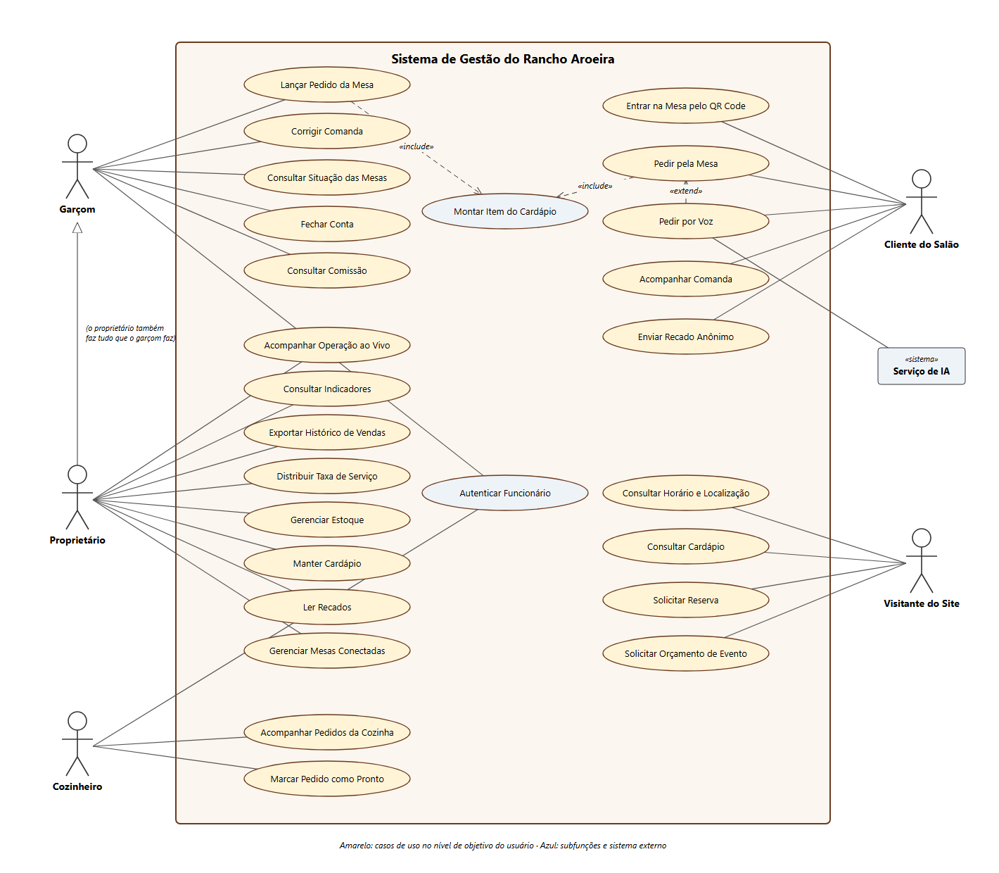

# UC04 — Pedir por Voz

**EEL873 — Engenharia de Software (UFRJ, 2026/2) · Grupo F · Sistema de Gestão do Rancho Aroeira**  
**Aluno:** Danilo Santiago Baptista

## 1. Diagrama de casos de uso do sistema

O diagrama é o mesmo para todo o grupo; cada integrante descreve um caso de uso. Lista completa de atores e casos de uso: [casos-de-uso.md](../casos-de-uso.md).

## 2. Caso de uso descrito

### UC04 — Pedir por Voz
**Responsável:** Danilo Santiago Baptista

| Campo | Descrição |
|---|---|
| **Escopo** | Sistema de Gestão do Rancho Aroeira, caixa-preta |
| **Nível** | Objetivo do usuário (estende *Pedir pela Mesa*) |
| **Ator principal** | Cliente do Salão |
| **Atores secundários** | Serviço de IA (transcrição e interpretação da fala) |
| **Interessados e interesses** | **Cliente:** pedir falando, como falaria ao garçom. **Proprietário:** que a IA não invente item nem preço e que o custo de uso seja controlado. **Cozinheiro:** receber o pedido com ponto e acompanhamentos. **ANPD:** áudio do cliente usado só para o pedido |
| **Ponto de extensão** | Passo 2 de *Pedir pela Mesa* (escolha do produto) |
| **Pré-condições** | Sessão da mesa aberta; o celular permite o uso do microfone (ou o cliente escolhe escrever) |
| **Gatilho** | O cliente toca no botão de falar |
| **Pós-condições de sucesso** | Os itens entendidos estão no carrinho da mesa, com tamanho, ponto e acompanhamentos, aguardando a confirmação do cliente (o envio segue em *Pedir pela Mesa*) |
| **Garantias em caso de falha** | Nenhum item é adicionado sem o cliente ver e confirmar; nada é enviado à cozinha por este caso de uso |

**Cenário principal**
1. O cliente segura o botão e fala o pedido (ex.: "uma picanha para dois, ao ponto, com farofa e duas cocas").
2. O cliente solta o botão.
3. O sistema envia o áudio ao Serviço de IA.
4. O Serviço de IA transcreve a fala.
5. O sistema envia o texto e o cardápio vigente ao Serviço de IA.
6. O Serviço de IA devolve os itens interpretados.
7. O sistema valida cada item contra o cardápio (produto existente, tamanho, ponto, acompanhamentos permitidos) e monta os itens com os preços do cardápio.
8. O sistema responde em texto o que entendeu e mostra os itens para confirmação.
9. O cliente confirma.
10. O sistema adiciona os itens ao carrinho; o caso de uso retorna a *Pedir pela Mesa* no passo 4.

**Fluxos alternativos**
- **1a. O cliente prefere escrever:** 1a.1. O cliente digita o pedido. 1a.2. Segue no passo 5.
- **2a. O cliente arrasta para cima para travar a gravação:** 2a.1. O sistema continua gravando sem precisar segurar. 2a.2. O cliente toca em enviar ou descartar. 2a.3. Se enviar, segue no passo 3; se descartar, o caso de uso termina.
- **3a. O áudio está em silêncio ou curto demais:** 3a.1. O sistema avisa que não ouviu nada. 3a.2. Volta ao passo 1.
- **3b. A mesa atingiu o limite de falas da sessão:** 3b.1. O sistema sugere usar o cardápio ou chamar o garçom. 3b.2. O caso de uso termina.
- **6a. O pedido é ambíguo (ex.: "uma picanha" — há a normal, a premium e a do prato executivo):** 6a.1. O sistema pergunta ao cliente qual delas, com as opções e os preços do cardápio. 6a.2. O cliente responde falando ou escrevendo. 6a.3. Volta ao passo 5, com o histórico da conversa.
- **6b. Faltam informações obrigatórias (ex.: o ponto da carne):** 6b.1. O sistema anota o que entendeu e pergunta o que falta. 6b.2. Volta ao passo 1.
- **6c. O cliente fez uma pergunta sobre o cardápio:** 6c.1. O sistema responde com base no cardápio. 6c.2. Volta ao passo 1.
- **6d. O Serviço de IA não responde:** 6d.1. O sistema tenta outro modelo de IA. 6d.2. Se nenhum responder, avisa e sugere o cardápio por toque; o caso de uso termina.
- **7a. A IA devolveu item que não existe no cardápio:** 7a.1. O sistema descarta o item e informa o cliente. 7a.2. Segue no passo 8 com os itens válidos.
- **9a. O cliente corrige algo:** 9a.1. O cliente fala a correção. 9a.2. Volta ao passo 3.

**Requisitos especiais**
- A IA **nunca define preço nem envia pedido**: preços vêm do cardápio e o envio exige a confirmação do cliente.
- Ambiguidades decididas por regra do sistema (a IA só redige a pergunta), para não esconder opções do cliente.
- Limite de falas por sessão e intervalo mínimo entre falas, para controlar custo e abuso.
- Priorizar serviço de IA com plano gratuito; o pago só como reserva.
- O áudio é usado só para transcrever o pedido; a fala transcrita fica guardada por prazo limitado para melhorar o sistema.

**Variações tecnológicas e de dados:** gravação por *MediaRecorder* no navegador (áudio em webm no Android e mp4 no iPhone); entrada por texto como alternativa.
**Frequência:** parte dos pedidos feitos pela mesa; tende a crescer entre clientes com pouca familiaridade com o cardápio digital.
**Questões em aberto:** qual o limite ideal de falas por mesa? A IA deve sugerir acompanhamentos ou só registrar o que o cliente pediu?
