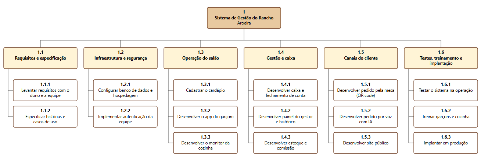
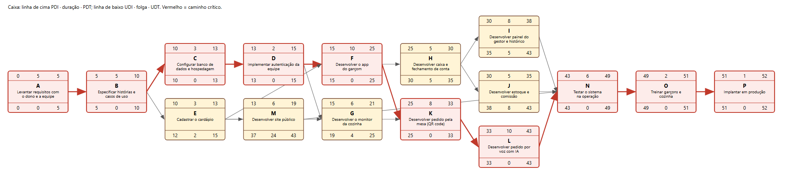
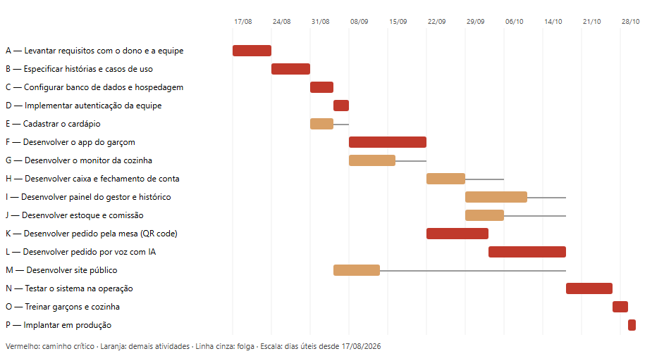

# Planejamento do Projeto — Sistema de Gestão do Rancho Aroeira

**EEL873 — Engenharia de Software (UFRJ, 2026/2) · Grupo F:** João Paulo Garcia · Gabriel dos Santos Percu Saldanha · Henrique Gebara · Danilo Santiago Baptista

Conteúdo: 1. Descrição do escopo · 2. EAP · 3. Diagrama de rede e tabela · 4. Cronograma (linha de base) · 5. Recursos por atividade · 6. Custos e BAC

## 1. Descrição do escopo

**Objetivo do projeto.** Desenvolver e implantar um sistema web de gestão para o Rancho Aroeira, churrascaria de Itaperuna (RJ) com 15 mesas, substituindo a comanda de papel por pedidos digitais que vão direto da mesa à cozinha, e dando ao proprietário informações confiáveis de vendas, estoque e comissões.

**Justificativa.** Hoje os pedidos são anotados em papel e levados à cozinha a pé; erros de comanda, demora e falta de histórico de vendas dificultam a operação e a gestão (ver a [proposta](README.md) e os [desejos das partes interessadas](desejos-partes-interessadas.md)).

**Entregas do projeto (o que está no escopo):**

| Entrega | Descrição |
|---|---|
| Requisitos e especificação | Requisitos validados com o proprietário e a equipe; histórias do usuário; diagrama e casos de uso |
| Infraestrutura e segurança | Banco de dados, hospedagem, domínio, login por PIN e perfis de acesso (garçom, cozinha, proprietário) |
| Operação do salão | Cardápio digital; app do garçom (mesas, pedidos, correções); monitor da cozinha e do bar em tempo real |
| Gestão e caixa | Fechamento de conta com taxa de serviço opcional; painel do gestor com indicadores; exportação do histórico; estoque; comissão dos garçons |
| Canais do cliente | Pedido e comanda pelo celular via QR code da mesa; pedido por voz ou texto com IA; site público com horário, localização, cardápio, reservas e orçamentos |
| Testes, treinamento e implantação | Testes em almoços reais, treinamento da equipe e entrada em produção |

**Fora do escopo:** emissão de nota fiscal eletrônica; pagamento on-line pelo celular; delivery e integração com aplicativos de entrega; aplicativo nativo de loja (o sistema roda no navegador); controle financeiro e contábil completo.

**Critérios de aceitação.** Um almoço inteiro operado só pelo sistema, sem comanda de papel; todo pedido lançado aparece na cozinha em poucos segundos; o fechamento de conta bate com a soma dos itens; o proprietário consegue ver e exportar as vendas do dia.

**Premissas.** O restaurante tem internet Wi-Fi no salão; garçons usam o próprio celular; o proprietário dedica parte do tempo às atividades de requisitos, cadastro do cardápio, testes, treinamento e implantação; hospedagem, banco de dados e o serviço de IA do pedido por voz em planos gratuitos; o grupo usa o Claude Code (plano Max) como assistente de programação durante todo o desenvolvimento.

**Restrições.** Prazo do semestre letivo; orçamento pequeno (negócio familiar); equipe de quatro alunos em tempo parcial; o sistema não pode parar o atendimento durante a implantação.

## 2. EAP — Estrutura Analítica do Projeto

EAP orientada a **entregas**, em três níveis. Os elementos do último nível são os **pacotes de trabalho**; cada um vira uma atividade do cronograma (letras A–P). Pela **regra dos 100%**, a soma dos pacotes cobre todo o escopo descrito acima — e nada fora dele.

### Dicionário da EAP

| Código | Pacote de trabalho | Entregável | Ativ. |
|---|---|---|---|
| **1.1** | **Requisitos e especificação** | | |
| 1.1.1 | Levantar requisitos com o dono e a equipe | Lista de requisitos validada pelo proprietário | A |
| 1.1.2 | Especificar histórias e casos de uso | Histórias do usuário, casos de uso e critérios de aceitação | B |
| **1.2** | **Infraestrutura e segurança** | | |
| 1.2.1 | Configurar banco de dados e hospedagem | Banco de dados criado, hospedagem e domínio configurados | C |
| 1.2.2 | Implementar autenticação da equipe | Login com PIN por funcionário e perfis de acesso | D |
| **1.3** | **Operação do salão** | | |
| 1.3.1 | Cadastrar o cardápio | Cardápio completo cadastrado (produtos, opções, preços, pontos, acompanhamentos) | E |
| 1.3.2 | Desenvolver o app do garçom | App do garçom: mesas, lançamento e correção de pedidos | F |
| 1.3.3 | Desenvolver o monitor da cozinha | Monitor da cozinha e do bar em tempo real | G |
| **1.4** | **Gestão e caixa** | | |
| 1.4.1 | Desenvolver caixa e fechamento de conta | Fechamento de conta, taxa de serviço, formas de pagamento e cupom | H |
| 1.4.2 | Desenvolver painel do gestor e histórico | Painel do gestor, indicadores e exportação do histórico | I |
| 1.4.3 | Desenvolver estoque e comissão | Controle de estoque e cálculo da comissão dos garçons | J |
| **1.5** | **Canais do cliente** | | |
| 1.5.1 | Desenvolver pedido pela mesa (QR code) | Pedido e comanda pelo celular via QR code da mesa | K |
| 1.5.2 | Desenvolver pedido por voz com IA | Pedido por voz ou texto interpretado por IA, com confirmação do cliente | L |
| 1.5.3 | Desenvolver site público | Site público: horário, localização, cardápio, reservas e orçamentos | M |
| **1.6** | **Testes, treinamento e implantação** | | |
| 1.6.1 | Testar o sistema na operação | Sistema testado em almoços reais, defeitos corrigidos | N |
| 1.6.2 | Treinar garçons e cozinha | Equipe treinada e guia rápido de uso | O |
| 1.6.3 | Implantar em produção | Sistema em produção, com acompanhamento na primeira semana | P |

## 3. Diagrama de rede

Rede de atividades nos nós (método do caminho crítico). Durações em **dias úteis**. Em vermelho, o **caminho crítico**.

### Tabela da rede

PDI = primeira data de início · PDT = primeira data de término · UDI = última data de início · UDT = última data de término (contadas em dias úteis desde o início do projeto) · Folga total = UDI − PDI.

| Ativ. | Descrição | EAP | Duração | Predecessoras | PDI | PDT | UDI | UDT | Folga | Crítica |
|---|---|---|---|---|---|---|---|---|---|---|
| A | Levantar requisitos com o dono e a equipe | 1.1.1 | 5 | — | 0 | 5 | 0 | 5 | 0 | **sim** |
| B | Especificar histórias e casos de uso | 1.1.2 | 5 | A | 5 | 10 | 5 | 10 | 0 | **sim** |
| C | Configurar banco de dados e hospedagem | 1.2.1 | 3 | B | 10 | 13 | 10 | 13 | 0 | **sim** |
| D | Implementar autenticação da equipe | 1.2.2 | 2 | C | 13 | 15 | 13 | 15 | 0 | **sim** |
| E | Cadastrar o cardápio | 1.3.1 | 3 | B | 10 | 13 | 12 | 15 | 2 | não |
| F | Desenvolver o app do garçom | 1.3.2 | 10 | D, E | 15 | 25 | 15 | 25 | 0 | **sim** |
| G | Desenvolver o monitor da cozinha | 1.3.3 | 6 | D, E | 15 | 21 | 19 | 25 | 4 | não |
| H | Desenvolver caixa e fechamento de conta | 1.4.1 | 5 | F | 25 | 30 | 30 | 35 | 5 | não |
| I | Desenvolver painel do gestor e histórico | 1.4.2 | 8 | H | 30 | 38 | 35 | 43 | 5 | não |
| J | Desenvolver estoque e comissão | 1.4.3 | 5 | H | 30 | 35 | 38 | 43 | 8 | não |
| K | Desenvolver pedido pela mesa (QR code) | 1.5.1 | 8 | F, G | 25 | 33 | 25 | 33 | 0 | **sim** |
| L | Desenvolver pedido por voz com IA | 1.5.2 | 10 | K | 33 | 43 | 33 | 43 | 0 | **sim** |
| M | Desenvolver site público | 1.5.3 | 6 | E | 13 | 19 | 37 | 43 | 24 | não |
| N | Testar o sistema na operação | 1.6.1 | 6 | I, J, L, M | 43 | 49 | 43 | 49 | 0 | **sim** |
| O | Treinar garçons e cozinha | 1.6.2 | 2 | N | 49 | 51 | 49 | 51 | 0 | **sim** |
| P | Implantar em produção | 1.6.3 | 1 | O | 51 | 52 | 51 | 52 | 0 | **sim** |

**Caminho crítico:** A → B → C → D → F → K → L → N → O → P — **52 dias úteis**. Qualquer atraso nessas atividades atrasa o projeto inteiro.

## 4. Cronograma (linha de base)

Início em **17/08/2026**, dias úteis de segunda a sexta, sem os feriados nacionais do período. Término previsto: **29/10/2026**.

| Ativ. | Descrição | Início | Término | Duração (dias úteis) |
|---|---|---|---|---|
| A | Levantar requisitos com o dono e a equipe | 17/08/2026 | 21/08/2026 | 5 |
| B | Especificar histórias e casos de uso | 24/08/2026 | 28/08/2026 | 5 |
| C | Configurar banco de dados e hospedagem | 31/08/2026 | 02/09/2026 | 3 |
| D | Implementar autenticação da equipe | 03/09/2026 | 04/09/2026 | 2 |
| E | Cadastrar o cardápio | 31/08/2026 | 02/09/2026 | 3 |
| F | Desenvolver o app do garçom | 08/09/2026 | 21/09/2026 | 10 |
| G | Desenvolver o monitor da cozinha | 08/09/2026 | 15/09/2026 | 6 |
| H | Desenvolver caixa e fechamento de conta | 22/09/2026 | 28/09/2026 | 5 |
| I | Desenvolver painel do gestor e histórico | 29/09/2026 | 08/10/2026 | 8 |
| J | Desenvolver estoque e comissão | 29/09/2026 | 05/10/2026 | 5 |
| K | Desenvolver pedido pela mesa (QR code) | 22/09/2026 | 01/10/2026 | 8 |
| L | Desenvolver pedido por voz com IA | 02/10/2026 | 16/10/2026 | 10 |
| M | Desenvolver site público | 03/09/2026 | 11/09/2026 | 6 |
| N | Testar o sistema na operação | 19/10/2026 | 26/10/2026 | 6 |
| O | Treinar garçons e cozinha | 27/10/2026 | 28/10/2026 | 2 |
| P | Implantar em produção | 29/10/2026 | 29/10/2026 | 1 |

**Marcos:** requisitos aprovados (fim de B) · operação do salão pronta — garçom e cozinha (fim de F e G) · sistema completo para teste (início de N) · sistema em produção (fim de P).

## 5. Recursos necessários por atividade

| Recurso | Tipo | Custo | Descrição |
|---|---|---|---|
| Dev | trabalho | R$ 100,00 por dia | Desenvolvedor do grupo. 4 h/dia a R$ 25/h |
| Dono | trabalho | R$ 120,00 por dia | Proprietário. 4 h/dia a R$ 30/h (custo do tempo dele fora da operação) |
| Monitor da cozinha | material | R$ 800,00 (único) | Monitor/TV para a cozinha |
| Impressora térmica | material | R$ 450,00 (único) | Impressora de cupom do caixa |
| QR codes impressos | material | R$ 60,00 (único) | 15 placas de QR code para as mesas |
| Claude Code (plano Max 5x) | assinatura mensal | R$ 550,00 por mês | Assistente de IA para programação, usado pelo grupo durante todo o desenvolvimento: US$ 100/mês, convertidos a R$ 5,50 por dólar |

| Ativ. | Descrição | Recursos alocados |
|---|---|---|
| A | Levantar requisitos com o dono e a equipe | 2 Dev; 1 Dono |
| B | Especificar histórias e casos de uso | 2 Dev; Claude Code |
| C | Configurar banco de dados e hospedagem | 1 Dev; Claude Code |
| D | Implementar autenticação da equipe | 1 Dev; Claude Code |
| E | Cadastrar o cardápio | 1 Dev; 1 Dono |
| F | Desenvolver o app do garçom | 2 Dev; Claude Code |
| G | Desenvolver o monitor da cozinha | 1 Dev; Monitor da cozinha; Claude Code |
| H | Desenvolver caixa e fechamento de conta | 1 Dev; Impressora térmica; Claude Code |
| I | Desenvolver painel do gestor e histórico | 1 Dev; Claude Code |
| J | Desenvolver estoque e comissão | 1 Dev; Claude Code |
| K | Desenvolver pedido pela mesa (QR code) | 2 Dev; QR codes impressos; Claude Code |
| L | Desenvolver pedido por voz com IA | 2 Dev; Claude Code |
| M | Desenvolver site público | 1 Dev; Claude Code |
| N | Testar o sistema na operação | 2 Dev; 1 Dono; Claude Code |
| O | Treinar garçons e cozinha | 1 Dev; 1 Dono |
| P | Implantar em produção | 2 Dev; 1 Dono |

O **Claude Code** é **uma** assinatura mensal para o grupo: aparece nas atividades de especificação, desenvolvimento e testes, mas o custo é contado **por mês**, não por atividade — atividades em paralelo usam a mesma assinatura.

Hospedagem e banco de dados usam **planos gratuitos** (custo R$ 0) e os celulares são os que a equipe e os clientes já têm; por isso não entram no orçamento.

## 6. Custos e BAC

Custo de cada atividade = soma de (custo diário × unidades × duração) dos recursos de trabalho e de uso, mais os materiais de custo único. A assinatura do Claude Code entra como custo mensal do projeto, nos três meses do cronograma. O **BAC** (*Budget at Completion*, orçamento no término) é a soma dos custos planejados de todas as atividades — é o valor planejado total da linha de base, usado depois no gerenciamento do valor agregado (EVM).

| Ativ. | Descrição | Custo planejado (R$) | Custo acumulado (R$) |
|---|---|---|---|
| A | Levantar requisitos com o dono e a equipe | 1.600,00 | 1.600,00 |
| B | Especificar histórias e casos de uso | 1.000,00 | 2.600,00 |
| C | Configurar banco de dados e hospedagem | 300,00 | 2.900,00 |
| D | Implementar autenticação da equipe | 200,00 | 3.100,00 |
| E | Cadastrar o cardápio | 660,00 | 3.760,00 |
| F | Desenvolver o app do garçom | 2.000,00 | 5.760,00 |
| G | Desenvolver o monitor da cozinha | 1.400,00 | 7.160,00 |
| H | Desenvolver caixa e fechamento de conta | 950,00 | 8.110,00 |
| I | Desenvolver painel do gestor e histórico | 800,00 | 8.910,00 |
| J | Desenvolver estoque e comissão | 500,00 | 9.410,00 |
| K | Desenvolver pedido pela mesa (QR code) | 1.660,00 | 11.070,00 |
| L | Desenvolver pedido por voz com IA | 2.000,00 | 13.070,00 |
| M | Desenvolver site público | 600,00 | 13.670,00 |
| N | Testar o sistema na operação | 1.920,00 | 15.590,00 |
| O | Treinar garçons e cozinha | 440,00 | 16.030,00 |
| P | Implantar em produção | 320,00 | 16.350,00 |
| — | Assinatura Claude Code Max — agosto | 550,00 | 16.900,00 |
| — | Assinatura Claude Code Max — setembro | 550,00 | 17.450,00 |
| — | Assinatura Claude Code Max — outubro | 550,00 | 18.000,00 |
| | **BAC** | **18.000,00** | |

Atividades A–P: R$ 16.350,00 · Assinatura do Claude Code (3 meses × R$ 550,00): R$ 1.650,00.

**BAC = R$ 18.000,00.** Esse é o valor planejado (PV) acumulado no fim do cronograma (29/10/2026); durante a execução, o valor agregado (EV) e o custo real (AC) serão comparados a ele para calcular o desempenho de prazo (SPI = EV/PV) e de custo (CPI = EV/AC).
